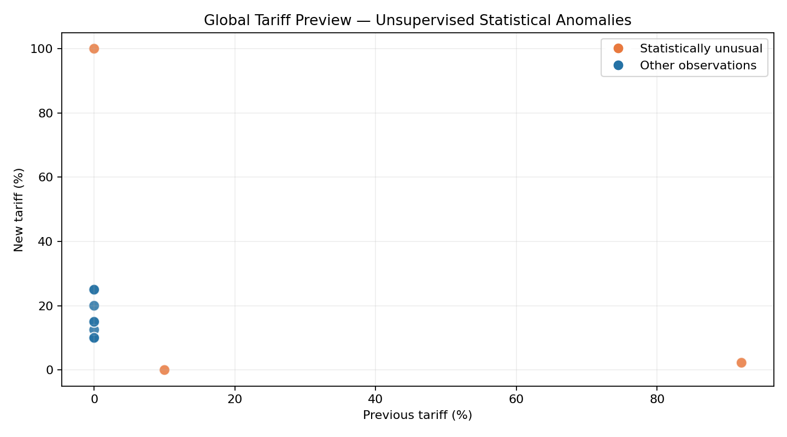

# Global Tariff Realignment — ML Demonstration

This educational demonstration uses the **Policy Action Summary** tab of the provided preview workbook, with **15 policy action records** (not 50 HTS records). The preview separately contains HTS line-item examples; those are not used to train this model.

## Method
Isolation Forest (200 trees, 20% contamination, random_state=42) on previous tariff, new tariff, and tariff change percentages after standard scaling. 12 numeric records were used; **3** were statistically flagged as unusual within this small sample. This is unsupervised anomaly detection, not forecasting.

## Run
`pip install pandas scikit-learn` then `python tariff_anomaly_demo.py`. Outputs `tariff_ml_results.csv`.

## Important limitations
The data are a **static reference preview**. The policy rows include secondary-source entries and scheduled dates, which may require independent primary-source verification. Statistical outliers do **not** indicate legal errors, inaccurate tariffs, trade risk, or future policy changes. Do not use for customs entry, compliance, or purchase decisions. Model outputs are highly sample-dependent.

Prepared as an educational reproducibility example for IT Altitudes Inc.
